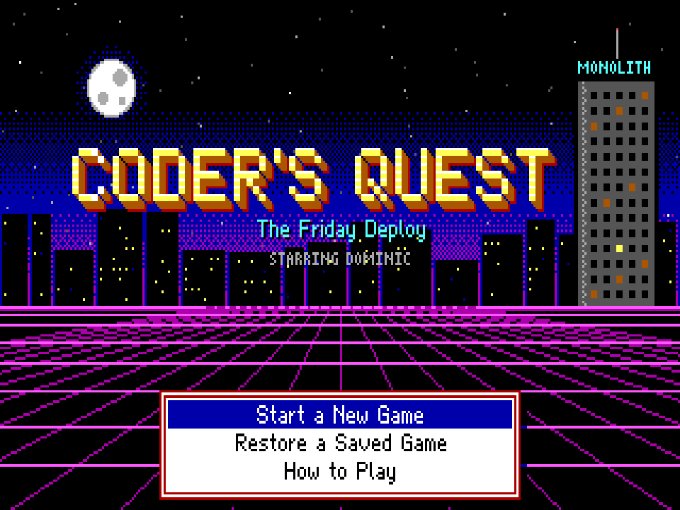
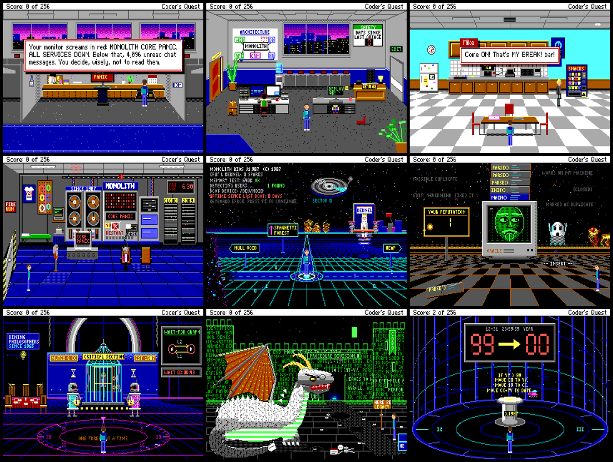

# Coder's Quest: The Friday Deploy

*A graphic adventure in the grand tradition of the 1980s Sierra classics. Starring Dominic.*



> **Friday, 4:59 PM.** One minute until a long weekend. Then Aidan the intern does his first
> production deploy, follows step four of an ancient runbook — *"Restart the Monolith"* — and
> presses the big red button. The Monolith, a 1987 mainframe that hasn't been rebooted since
> 1999, panics. Production is down. The doors are locked. The coffee machine thinks it's a
> teapot. The investors arrive Monday at nine.
>
> Somebody has to go down to the basement. And then somebody has to go *inside*.

Coder's Quest is a complete, fully playable adventure game built from scratch to look, sound and
play like a 1987 Sierra adventure (*Space Quest III*, *King's Quest IV*, *Leisure Suit Larry 2*):

- **320×200, 16-color EGA graphics** — every background is painted procedurally with
  Sierra-style vector fills and dithering, with a real priority layer so characters walk
  behind furniture.
- **A typed text parser** — `LOOK AT DESK`, `GIVE COFFEE TO FAHIM`, `USE BADGE ON READER`,
  `READ MANUAL TO DRAGON`. It understands hundreds of verbs, synonyms and phrasings.
- **256 points** to earn, a classic score line, and a rank at the end.
- **Many, many ways to die**, each with its own (hopefully funny) obituary — plus **Try Again**,
  because we're not monsters.
- **A three-voice chiptune soundtrack** composed in MML and synthesized live with Web Audio.
- **Save/Restore** (10 slots), a Sierra menu bar, speed settings, CRT scanlines, 4:3 monitor
  aspect.
- **A built-in hint system**: your rubber duck. Explain your problem to it (`TALK TO DUCK`).
  Ask twice for a more specific hint. In Act II, it talks back.



## Play it

### Option 1 — Just open it
Build once (see below) and double-click **`dist/index.html`**. The whole game is a single
self-contained HTML file: no server, no install, works offline in any modern browser on macOS,
Linux and Windows. You can email it to friends.

### Option 2 — Run from source
```bash
npm install
npm start          # opens http://localhost:5173 in your browser
```

### Option 3 — Build the single-file game
```bash
npm install
npm run build      # -> dist/index.html (self-contained)
```

### Option 4 — GitHub Pages
`docs/github-workflows/pages.yml` publishes the game on every push to `main`. To enable it, copy
it to `.github/workflows/pages.yml` and set **Settings → Pages → Source: GitHub Actions**.
(`docs/github-workflows/ci.yml` is a matching build check.)

## How to play

Just start typing. Press **Enter** to send a command.

| Action | How |
|---|---|
| Walk | Arrow keys (tap to start walking, tap again to stop — or hold) or click where you want to go |
| Look at something | `LOOK AT <thing>` — or right-click / shift-click it |
| Interact | `TAKE`, `OPEN`, `USE X ON Y`, `GIVE X TO Y`, `TALK TO`, `ASK X ABOUT Y`, `PUSH`, `TURN ON`, `WEAR`, `READ`… |
| Inventory | `Tab` or `INVENTORY` |
| Retype last command | `F3` (or ↑ in the input box) |
| Save / Restore / Restart | `F5` / `F7` / `F9` |
| Menu bar | `Esc` or move the mouse to the top of the screen |
| Sound on/off | `F2` |
| Help | `F1` |
| Stuck? | `TALK TO DUCK` |

Tips from 1987: **save often**, look at everything, read everything, and if a sign says not to
do something, think hard before doing it anyway.

## The cast

| | |
|---|---|
| **Dominic** | Senior software engineer. Our hero. Owner of a hoodie that has seen things. |
| **Aidan** | Summer intern. Did his first deploy. Pressed the button. |
| **Nicholas** | Frontend developer. Has been trying to center a div since Tuesday. |
| **Mike** | Mike from Sales. Owns the biggest power bank in the building. |
| **Fahim** | SRE on call. Awake for 36 hours. Running on fumes. |
| **Phil** | CEO. Loves process. Loves golf. Loves process about golf. |
| **Krishna** | R&D genius. Built a helmet that lets you debug a computer from the *inside*. |
| **Denis** | The legendary greybeard who wrote the Monolith in 1987 and never let it reboot. |
| **Adriana** | Lead architect. Went in first. Hasn't come out. |

## Under the hood

Everything is written from scratch in TypeScript with zero runtime dependencies:

```
src/engine/   EGA palette & dithering, software rasterizer with priority layer, bitmap fonts,
              A* pathfinding, actors & animation, the text parser, Sierra-style windows & menus,
              Web Audio MML synthesizer, save/restore, the game loop
src/art/      procedural scenery library + a parametric pixel-art character generator
src/content/  items, the 256-point table, the hint duck, parser fallbacks, music, title & ending
src/rooms/    one file per room
docs/         DESIGN.md (spoilers!) and ENGINE.md (how to add rooms)
scripts/      play.mjs — drives the game headlessly; walkthrough test
```

`npm test` plays the entire game from the title screen to the ending in a headless browser,
collecting all 256 points (requires Playwright: `npx playwright install chromium`).

**Spoilers:** a full walkthrough lives in [`docs/WALKTHROUGH.md`](docs/WALKTHROUGH.md).

## License

MIT — see [LICENSE](LICENSE). Coder's Quest is an original work and a loving tribute; it is not
affiliated with Sierra or any of its successors.
